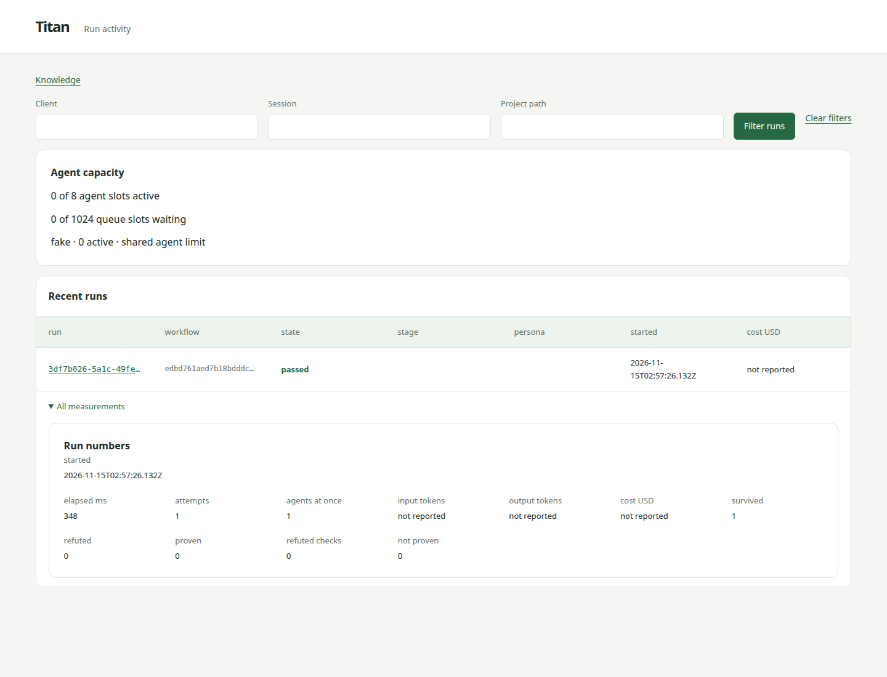
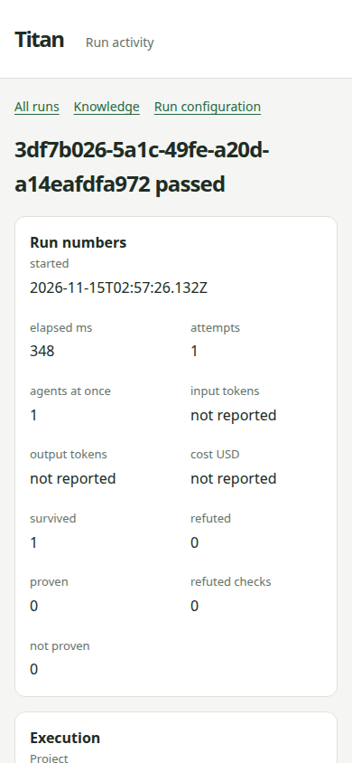
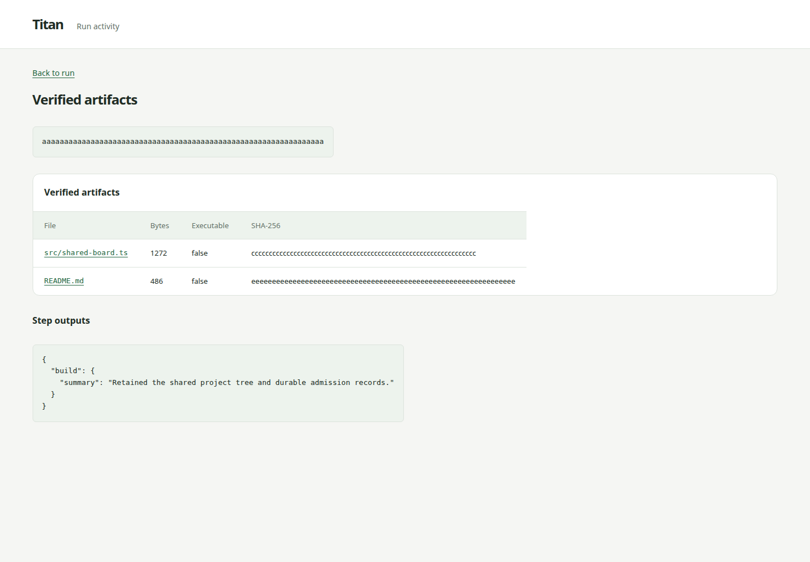

# Dashboard

The local dashboard shows run activity, evidence, open requests and shared knowledge. Titan serves the page on its authenticated local server.

## Open the dashboard

Run this command with the home that owns your runs.

```sh
titan dashboard --home HOME
```

Open the returned login link in your browser. Each link expires after one minute and works once. A successful login creates a browser session. Run the command again when you need another link.

## Inspect a run

The overview lists up to 200 runs per page. Use **Older runs** to continue through history and **Latest runs** to return. Page links retain client, harness-session and project filters. Select a run identifier to open its details. Use **All runs** to return or **Knowledge** to inspect the entries visible to that run.

Use the **Client**, **Session** and **Project path** fields to narrow the run list, then select **Filter runs**. Project paths must be absolute. Applying filters starts at the latest page. **Clear filters** returns to all runs. The overview pauses refresh while a filter field has focus so that typing stays uninterrupted.

Run details include recorded usage, attempts, simultaneous agents, refutations and proof counts. A complete measure contains all reported contributions. A partial subtotal names missing contributions. An unreported measure appears as **not reported**. The overview shows run and workflow identity, status, stage, persona, start time and cost. Missing run numbers leave their overview cells empty. Expand **All measurements** for recorded usage, elapsed time, attempts, concurrency, refutations and proof counts. Open a run to inspect its steps and evidence. Long identifiers retain their full text in hover labels and run links.

The overview reports active agent slots, queued work and configured backend limits. These values describe the current server. Run details show the selected backend, pinned runtime when recorded, shared project path, frozen run parallel limit and artifact location.

Steps show their dependencies, attempt verdicts, evidence and check answers. Incomplete phases show physical execution and recovery retry counts, the next scheduled retry, retained-result capture state and recorded errors. Open requests include the terminal command used to answer them. Read the request before submitting an answer.

Open **Run configuration** to inspect the settings frozen for that run, their source paths and the configuration SHA-256. The view reads committed run state. Editing the home or project configuration applies to new runs. Use **Back to run** to return to live activity.

## Inspect delivered files

Select **Verified artifacts** in a run with a delivered result. The file list shows each path, byte count, executable flag and SHA-256 digest, followed by the recorded step outputs. Select a file to inspect its content. **Next file page** and **First file page** navigate bounded byte ranges. UTF-8 content appears as literal text. Other byte sequences appear as base64.

Each inspection verifies the delivered files, manifest, result document and journal commitment. Changed delivery bytes cause the view to fail. **Back to run** returns to the run details.

## Follow activity

Run details and the overview refresh every two seconds. Board events arrive through an event stream. The connection message reports connection and recovery state. The page retains the latest 200 streamed events and deduplicates replayed event identifiers. Revisiting a run retains its event cursor within the most recent 200 visited runs.

## Recover a failed view

A failed request offers **Try again**. Check that the server is running, then retry. When the page asks for a session cookie, run `titan dashboard --home HOME` again and open its new link. Navigation cancels requests for the previous view. Requests time out after ten seconds.

## Inspect knowledge

Knowledge views show committed entries, scope and kind counts, date ranges, model readiness, pending changes and retained history. Filter links narrow scope, kind, state or tag. Open an entry to inspect its content, provenance and earlier versions. Entry content remains literal text in the browser.

## Browser examples

The overview and mobile captures use the actual local server with a controlled fake backend and synthetic records. The mobile viewport is 390 pixels. Artifact inspection uses a deterministic local preview.







## Delivery status

The installed package includes its built browser assets. Opening the dashboard uses those assets directly. Source-checkout execution builds the browser page from source.

Configuration inspection and persisted overview measures are implemented. The [dashboard specification](../openspec/changes/resilient-agent-blackboard-bun/specs/run-dashboard/spec.md) records their acceptance contract. The combined product production acceptance remains open. See the [repair record](../openspec/changes/repair-harness-delivery/HANDOFF.md) for verification evidence and remaining delivery work.
